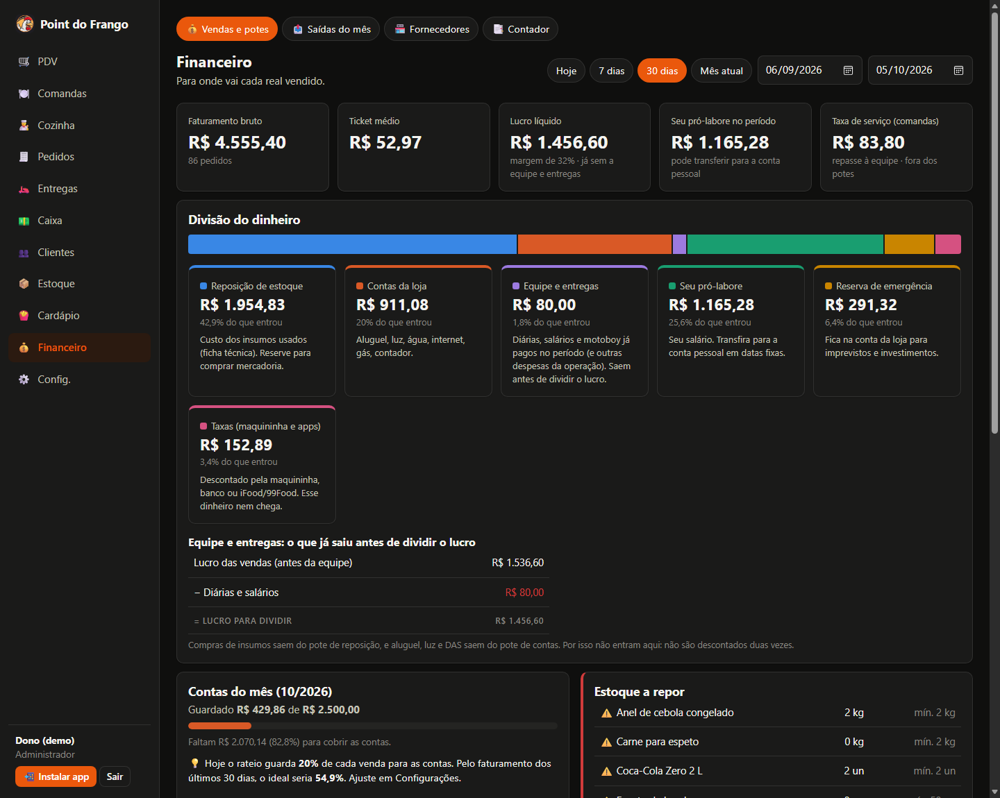
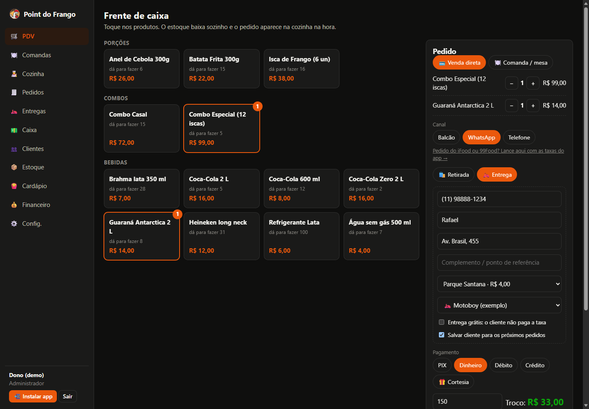
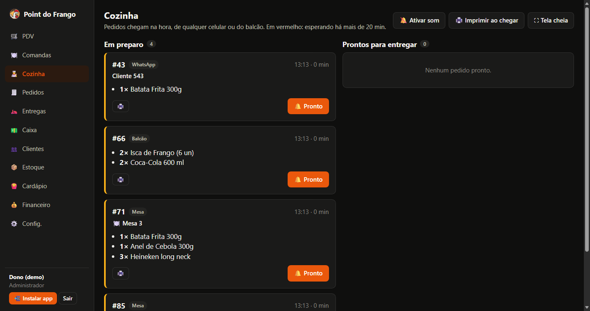
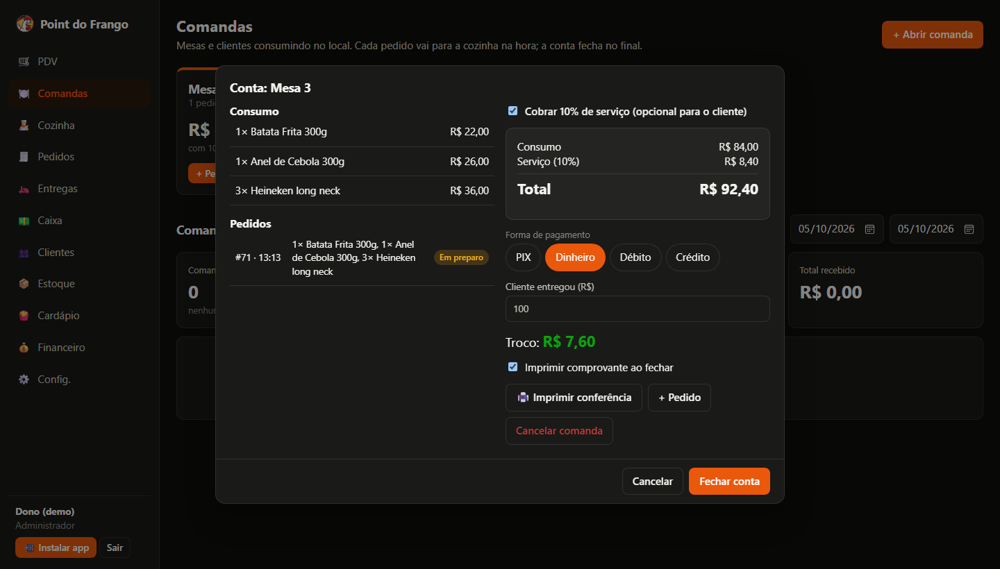
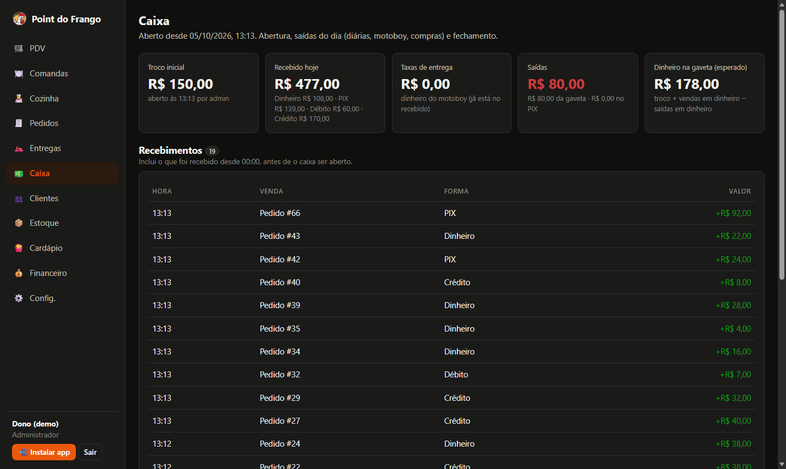
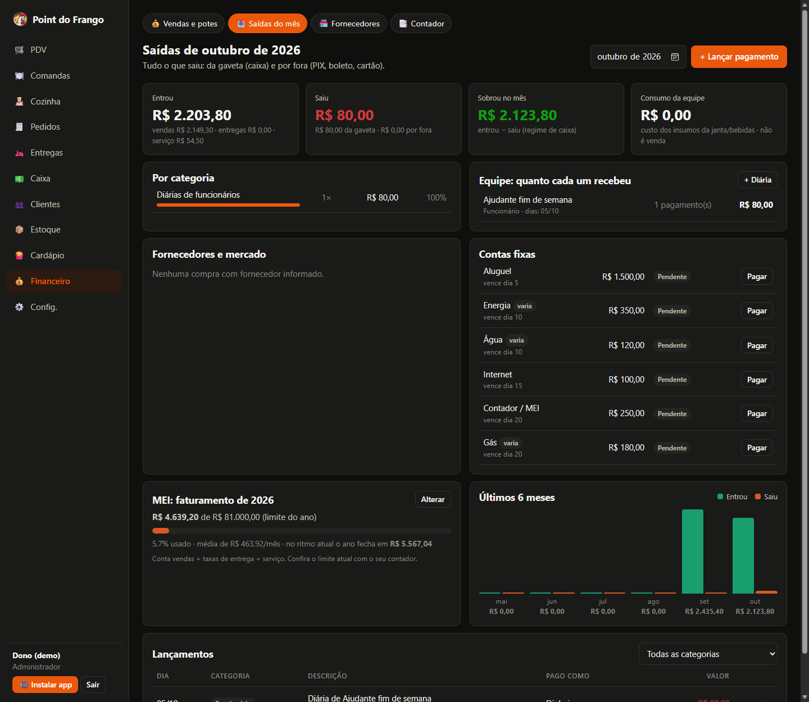
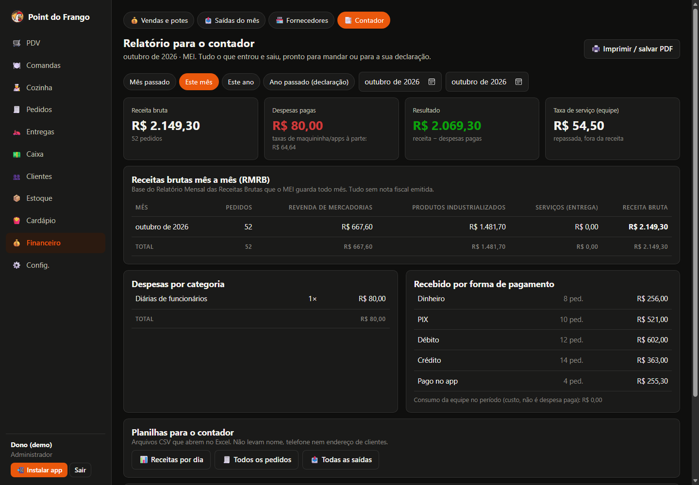
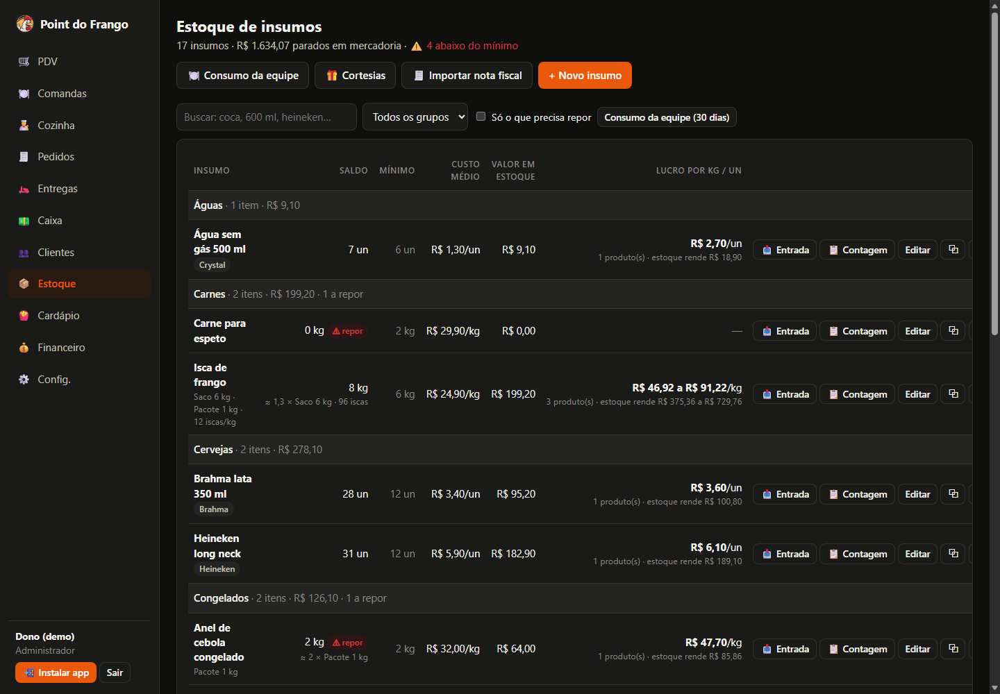
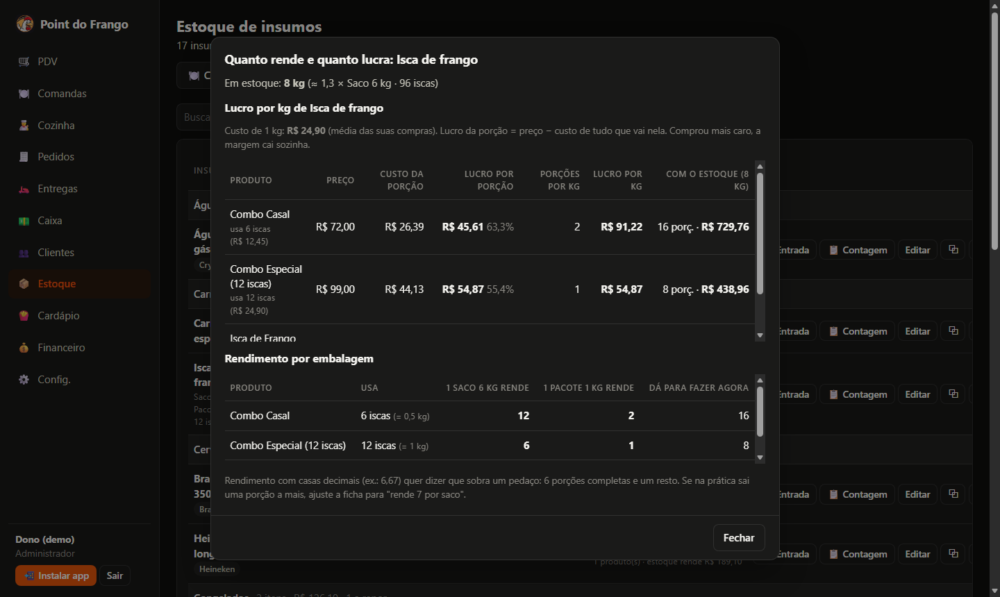
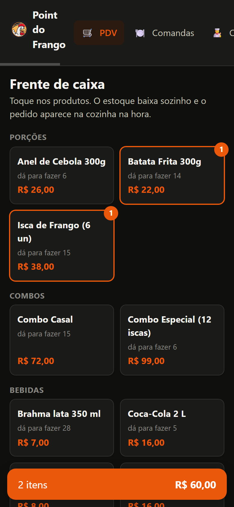

# Point do Frango

[](https://github.com/wescoelho96/point-do-frango/actions/workflows/ci.yml)
[](https://github.com/wescoelho96/point-do-frango/actions/workflows/codeql.yml)


Sistema de gestão para lanchonete em produção: **PDV, comandas, cozinha em tempo real, entregas, estoque por
ficha técnica, caixa e financeiro**, construído em Java 17 + Spring Boot 3 e usado na operação diária do
Point do Frango (iscas, porções e combos).

Cada pedido lançado no balcão, na mesa, pelo WhatsApp ou pelo próprio cliente no cardápio online:

1. baixa o estoque insumo por insumo, a partir da ficha técnica ("12 iscas = 1 kg de frango");
2. calcula o custo real (CMV) pelo custo médio ponderado das compras;
3. divide o valor em potes: taxas, reposição de estoque e a cota diária das contas da loja; o que passa da cota
   vira pró-labore e reserva no mesmo dia.



| PDV com entrega e troco | Cozinha em tempo real | Conta da mesa com 10% opcional |
|---|---|---|
|  |  |  |

| Caixa do dia | Saídas do mês | Relatório para o contador |
|---|---|---|
|  |  |  |

| Estoque por grupo e marca | Lucro por kg de cada insumo | Celular |
|---|---|---|
|  |  |  |

## Funcionalidades

**Vendas**
- Cardápio online público: o cliente monta o pedido, vê a taxa de entrega do bairro e o pedido cai direto na cozinha.
- PDV para balcão, WhatsApp e telefone, com desconto, troco e conta dividida em várias formas de pagamento.
- Comandas de mesa com vários pedidos, conferência impressa, taxa de serviço opcional e fechamento dividido entre pessoas.
- Entregas por bairro com taxa cadastrada, entrega grátis por dia da semana, entrega feita pelo dono ou pelo motoboy.
- Promoções com brinde ("comprou o combo, ganha o refrigerante") e cortesias registradas.
- Pedidos de iFood e 99Food lançados com as taxas reais do app.
- Cozinha (KDS) em tempo real via Server-Sent Events, com som e impressão automática; pedido só de bebida não passa pela cozinha.
- Cupom em impressora térmica 58/80 mm.

**Estoque e cardápio**
- Ficha técnica em g, ml, unidades de uso ou rendimento por embalagem; custo, margem e CMV calculados.
- Custo médio ponderado, extrato imutável, contagem física e alerta de mínimo.
- Saldo de cada insumo em vendas possíveis ("dá para 4 batatas grandes ou 9 pequenas").
- Lucro por kg de cada insumo e projeção de lucro da compra.
- Importação de NF-e (XML) e de cupom NFC-e pelo QR Code, escolhendo item a item o que entra no estoque.
- Consumo da equipe baixado do estoque sem gerar venda.

**Caixa e financeiro**
- Abertura com troco, recebimentos por forma de pagamento, saídas (diárias, motoboy, compras) e fechamento cego para o atendente.
- Acerto do motoboy: diária + taxas das entregas.
- Rateio "contas por dia trabalhado": as contas fixas do mês viram uma cota diária pelos dias em que a loja abre; a
  sobra de cada venda paga a cota do dia e o resto é o pró-labore daquele dia. Com ponto de equilíbrio e quanto falta vender.
- Saídas do mês por categoria, pessoa e fornecedor.
- Contas fixas com valor variável lido pelo código de barras do boleto (dígitos verificadores conferidos).
- Acompanhamento do limite de faturamento do MEI e relatório para o contador (RMRB, DASN-SIMEI e planilhas CSV).

**Segurança e LGPD**
- JWT com perfis (Administrador, Atendente, Cozinha) e telas liberadas por usuário; BCrypt e bloqueio por tentativas.
- Sessão revogada na hora ao trocar a senha, desativar o usuário ou mudar o perfil.
- CSP sem script inline, HSTS, Permissions-Policy, COOP, X-Frame-Options e Referrer-Policy.
- Cardápio público com preço sempre do servidor, limite de pedidos por telefone e por IP e campo anti-robô.
- Documentação da API desligada em produção; CodeQL e Dependabot no repositório.
- Atendente não vê custos nem margens; fechamento de caixa cego.
- Cliente com dados mínimos, busca só por telefone exato, exclusão a pedido do titular e retenção automática de 12 meses.
- RLS ligado em todas as tabelas no Supabase para bloquear a API REST pública.

## Stack

| Camada | Tecnologia |
|---|---|
| Linguagem | Java 17 |
| Framework | Spring Boot 3.5 (Web, Data JPA, Validation, Security, OAuth2 Resource Server, Actuator) |
| Banco | PostgreSQL (Supabase); H2 para desenvolvimento e testes |
| Migrações | Flyway |
| Front-end | HTML, CSS e JavaScript (ES Modules) servidos pelo Spring; PWA instalável |
| Tempo real | Server-Sent Events |
| Testes | JUnit 5, AssertJ, MockMvc, Spring Boot Test (mais de 140 testes) |
| CI | GitHub Actions (build e testes), CodeQL e Dependabot |
| Deploy | Docker multi-stage, usuário sem privilégios, no Render |

## Rodando localmente

Pré-requisito: JDK 17. O Maven Wrapper e o banco H2 já vêm no projeto.

```bash
./mvnw spring-boot:run          # Windows: mvnw.cmd spring-boot:run
```

Acesse http://localhost:8080. O perfil `dev` carrega um cardápio e pedidos de exemplo:

| Usuário | Senha | Perfil |
|---|---|---|
| `admin` | `admin123` | Administrador |
| `caixa` | `caixa123` | Atendente |
| `cozinha` | `cozinha123` | Cozinha |

Esses usuários existem apenas no perfil de demonstração. Os dados locais ficam em `./dados` (fora do Git).

- API: http://localhost:8080/swagger-ui.html (só no perfil `dev`)
- Cardápio online: http://localhost:8080/pedir
- Testes: `./mvnw test`

## Deploy (Render + Supabase)

1. No Supabase, copie a connection string JDBC do **Session pooler** (porta 5432).
2. No Render, crie o serviço pelo [`render.yaml`](render.yaml) (Blueprint) ou como Web Service Docker.
3. Configure as variáveis de [`.env.example`](.env.example): `DB_URL`, `DB_USERNAME`, `DB_PASSWORD`, `APP_JWT_SECRET`,
   `APP_ADMIN_USERNAME` e `APP_ADMIN_PASSWORD`.
4. No primeiro start o Flyway cria o banco e o administrador é criado a partir das variáveis.

Nenhum segredo fica no código; em produção não existe usuário padrão.

## Arquitetura

Monólito modular organizado por funcionalidade (`pedido`, `estoque`, `caixa`, `saida`, `contador`...), com regras
de negócio nas entidades e services finos.

O [guia de uso](docs/GUIA-DE-USO.md) descreve a operação do sistema passo a passo, para treinamento da equipe.

Algumas decisões:

- Valores em `BigDecimal`; os potes derivados são calculados por subtração para nunca sobrar ou faltar centavo.
- Preço e custo sempre vêm do banco e ficam congelados no item do pedido.
- `SELECT ... FOR UPDATE` no estoque: dois pedidos simultâneos não vendem a mesma última porção (teste com 20 threads).
- Eventos de domínio para desacoplar módulos (compra paga vira saída; cliente apagado anonimiza pedidos).
- Leitura de XML de NF-e protegida contra XXE; CSV exportado protegido contra injeção de fórmula.

## Roadmap

- [x] Cardápio online com pedido direto para a cozinha
- [ ] Integração com a maquininha Mercado Pago Point (valor enviado pelo sistema e taxa real por venda)
- [ ] Multiloja para outras lanchonetes
- [ ] App Android na Google Play
- [ ] Integração automática iFood e 99Food
- [ ] Emissão de NFC-e

---

Desenvolvido por **Wesley Coelho**.
